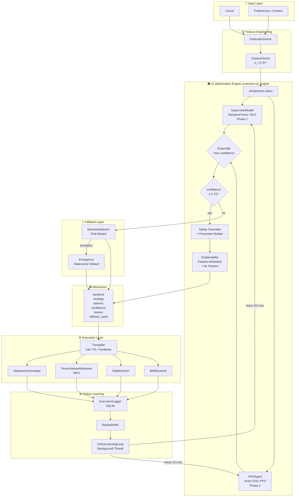

# Zuntenium AI Optimization Engine
## Complete Architecture, MDP Formulation & Future Roadmap

---

## 1. Architecture & Data-Flow



---

## 2. Step 1 — MDP + Supervised Formulation

### 2.1 Supervised Learning View (Phase 1)

Given a dataset $\mathcal{D} = \{(\mathbf{s}_i, a_i^*, r_i)\}_{i=1}^N$ of past executions:

$$\mathbf{s}_t = [\underbrace{s^{\text{circuit}}}_{\text{14 dims}}\; |\; \underbrace{s^{\text{context}}}_{\text{6 dims}}\; |\; \underbrace{s^{\text{history}}}_{\text{7 dims}}] \in \mathbb{R}^{27}$$

**Objective:** Learn $f_\theta : \mathbb{R}^{27} \to \Delta^{K-1}$ minimising cross-entropy:

$$\mathcal{L}_{\text{SL}} = -\frac{1}{N}\sum_{i=1}^{N} \log f_\theta(a_i^* \mid \mathbf{s}_i)$$

Labels $a^* = \arg\max_{a \in \mathcal{A}} r(s, a)$ are the historically best-performing actions.

### 2.2 Reinforcement Learning View (Phase 2 — PPO)

**MDP tuple:** $(\mathcal{S}, \mathcal{A}, \mathcal{P}, \mathcal{R}, \gamma)$

| Component | Definition |
|-----------|-----------|
| $\mathcal{S}$ | $\mathbb{R}^{27}$ — FeatureVector |
| $\mathcal{A}$ | $\{0,\ldots,15\}$ — 4 backends × 4 strategies |
| $\mathcal{P}$ | Stochastic (hardware queue, noise) |
| $\mathcal{R}$ | $r_t = \alpha \cdot \text{fidelity} - \beta\log(1+t_{\text{exec}}) - \gamma \cdot \mathbb{1}[\text{fallback}]$ |
| $\gamma$ | 0.99 |

**Reward function** ($\alpha=1.0, \beta=0.1, \gamma=0.2$):

$$r_t = \alpha \cdot F_t - \beta \ln(1 + t_t) - \gamma \cdot \mathbb{1}[{\text{fallback}_t}] - \delta \cdot \mathbb{1}[{\neg\text{success}_t}]$$

clipped to $[-2, 1]$.

**PPO Loss:**

$$L^{\text{PPO}} = \hat{\mathbb{E}}_t\left[\min\left(\rho_t \hat{A}_t,\; \text{clip}(\rho_t, 1-\varepsilon, 1+\varepsilon)\hat{A}_t\right)\right]$$

$$L^{\text{total}} = -L^{\text{PPO}} + c_1 L^{VF} - c_2 H[\pi_\theta(\cdot|s_t)]$$

where $\rho_t = \frac{\pi_\theta(a_t|s_t)}{\pi_{\theta_{\text{old}}}(a_t|s_t)}$, $c_1=0.5$, $c_2=0.01$.

**GAE Advantage:**

$$\hat{A}_t = \sum_{k=0}^{T-t-1} (\gamma\lambda)^k \delta_{t+k}, \qquad \delta_t = r_t + \gamma V(s_{t+1}) - V(s_t)$$

---

## 3. Feature Engineering

### FeatureVector (27 dimensions)

| Group | Features | Count |
|-------|---------|-------|
| Circuit | num_qubits, depth, gate_count, entanglement_score, clifford_fraction, parametric_fraction, connectivity_density, estimated_memory_mb, two_qubit_gate_count, single_qubit_gate_count, t_gate_count, max_gate_arity, circuit_volume, sv_feasible | 14 |
| Context | hardware_available, queue_time_s, system_load, noise_model_req, shots_log10, real_hw_req | 6 |
| History | avg_exec_time_10, success_rate_20, prev_{sv,tn,ibm,stab}, log_total_executions | 7 |

### Database Schema

```sql
CREATE TABLE executions (
    id                   INTEGER PRIMARY KEY AUTOINCREMENT,
    timestamp            REAL    NOT NULL,
    datetime_utc         TEXT    NOT NULL,
    circuit_name         TEXT,
    num_qubits           INTEGER,
    features_json        TEXT    NOT NULL,    -- serialised FeatureVector
    decision_backend     TEXT    NOT NULL,
    decision_strategy    TEXT    NOT NULL,
    decision_params_json TEXT,
    decision_confidence  REAL,
    decision_reason      TEXT,
    decision_source      TEXT,
    fallback_used        INTEGER DEFAULT 0,
    execution_time_s     REAL,
    fidelity             REAL,
    success              INTEGER DEFAULT 1,
    error_message        TEXT,
    reward               REAL
);
```

---

## 4. File Structure

```
zuntenium/
├── ai_engine/
│   ├── __init__.py          — public API exports
│   ├── features.py          — FeatureVector + FeatureExtractor
│   ├── decision.py          — AIDecision + BackendChoice + TranspilationStrategy
│   ├── logger.py            — ExecutionLogger (SQLite, WAL mode)
│   ├── models.py            — SupervisedModel + PPOAgent + ReplayBuffer
│   ├── optimizer.py         — AIOptimizer (core decision engine)
│   └── online_loop.py       — OnlineLearningLoop (background thread)
│
├── executor_ai_integration.py  — AIAwareHybridExecutor + AIAwareQuantumExecutor
│
└── data/
    └── execution_history.db    — SQLite database (auto-created)

tests/
└── test_ai_engine.py           — Comprehensive test suite (700+ lines)
```

---

## 5. Activation & Usage

### Drop-in replacement (zero breaking changes)

```python
# BEFORE (rule-based — unchanged)
from zuntenium.executor import HybridExecutor
executor = HybridExecutor()
result = executor.run(circuit)

# AFTER (AI-powered)
from zuntenium.executor_ai_integration import AIAwareHybridExecutor

executor = AIAwareHybridExecutor(
    optimization_mode="ai",       # "rule" = legacy default
    model_path="models/ai",       # checkpoint directory
    use_rl=True,                  # Phase 2 PPO (requires torch)
    retrain_every=50,             # supervised retrain cadence
    rl_update_every=10,           # PPO update cadence
)

with executor:                    # context manager handles graceful shutdown
    result = executor.run(
        circuit,
        shots=4096,
        hardware_available=True,
        queue_time_estimate_s=30.0,
    )

# Inspect decision history
for row in executor.get_decision_history(n=5):
    print(row)
```

### Using AIOptimizer directly

```python
from zuntenium.ai_engine import AIOptimizer, ExecutionLogger

logger = ExecutionLogger("data/history.db")
opt    = AIOptimizer(rule_selector=my_backend_selector, logger=logger, use_rl=True)

decision = opt.select(circuit, preferences={"shots": 1024})
print(decision)
# → AIDecision(backend=tensornetwork, strategy=rl_refine, confidence=0.87,
#              reason="TensorNetwork/MPS chosen: 24 qubits, entanglement=0.38...")

# After execution
opt.record_outcome(circuit, decision, execution_time_s=1.2, fidelity=0.98, success=True)

# Force retrain
opt.retrain_supervised()
opt.update_rl()
```

---

## 6. Safety Contract

| Condition | Behaviour |
|-----------|-----------|
| `confidence < 0.70` | Delegate to rule-based BackendSelector |
| Model not yet trained | Always fallback (confidence = 0.0) |
| `num_qubits > 28` + statevector chosen | Override → TensorNetwork |
| `clifford_fraction < 0.95` + stabilizer chosen | Override → Statevector |
| IBM backend + no transpilation | Override → hardware_aware strategy |
| Any exception in select() | Return `make_emergency_decision()` |
| Any exception in record_outcome() | Log warning, continue (non-fatal) |

---

## 7. Performance Characteristics

| Metric | Target | Notes |
|--------|--------|-------|
| Inference latency | < 10 ms | Tested at p50 over 20 runs |
| RF training (1000 samples) | < 500 ms | n_jobs=-1 |
| PPO update (512 samples) | < 200 ms | CPU-only |
| SQLite write | < 5 ms | WAL mode |
| Feature extraction | < 1 ms | Pure numpy |

---

## 8. Future Evolution Roadmap

### v0.3 — Multi-Objective RL
- Pareto-optimal policy: minimise `(exec_time, cost_usd, gate_error)` simultaneously
- Use Multi-Objective PPO or MORL with scalarised reward with user-configurable weights
- `AIDecision` extended with `pareto_front: list[AIDecision]`

### v0.4 — Cost-Aware Scheduling
- Integrate IBM Quantum pricing API for real-time cost estimation
- Add `cost_estimate_usd` to FeatureVector and reward function
- Budget constraints: `max_cost_usd` preference key

### v0.5 — LLM-Guided Optimisation
- Natural-language circuit description → structured FeatureVector via Claude API
- LLM explains complex decisions in domain-specific language
- `AIDecision.reason` becomes a full structured paragraph with citations

### v0.6 — Distributed Training
- Federated learning across multiple Zuntenium deployments
- Differential privacy on execution logs
- Global model aggregation with FedAvg

### v0.7 — Predictive Noise Mitigation
- Predict noise profile from device calibration data
- Auto-select error mitigation strategy (ZNE, PEC, Clifford data regression)
- Joint decision: backend + noise model + mitigation strategy

### v1.0 — Autonomous Quantum Operating System
- Self-healing: auto-detect hardware degradation, reroute
- Circuit portfolio optimisation: batch scheduling across QPUs
- Continuous A/B testing of new backend algorithms
- Full observability: OpenTelemetry traces per circuit execution
