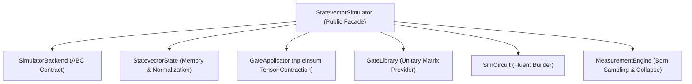

# ZQL-02A | OOP Operations & Architecture Guide

## Learning Objectives
- Master the object-oriented architecture and modular design of the Zuntenium SDK.
- Understand the role and responsibilities of the decoupled statevector core modules.
- Learn the `SimulatorBackend` and `QuantumBackend` abstract contracts.
- Study the mechanics of tensor contraction in `GateApplicator` and Born-rule collapse in `MeasurementEngine`.
- Learn how to implement noisy mixed-state simulation via `DensityMatrixSimulator`.
- Build a custom extensible backend by implementing SDK contracts.

---

## 1. Architectural Philosophy & The Decoupled Core

Early versions of quantum simulation frameworks often concentrate state representation, gate math, circuit building, and measurement sampling into monolithic classes ("God classes"). In Zuntenium (refactored under Option A/O6), the statevector simulation engine is cleanly decoupled into focused, single-responsibility modules under `zuntenium.quantum_core.statevector`:



### Module Responsibilities at a Glance

| Module | Primary Class | Responsibility |
|:-------|:--------------|:---------------|
| [`simulator_backend.py`](file:///home/vincent/Downloads/zuntenium/zuntenium/quantum_core/statevector/simulator_backend.py) | `SimulatorBackend` | Abstract Base Class defining the backend lifecycle. |
| [`statevector_state.py`](file:///home/vincent/Downloads/zuntenium/zuntenium/quantum_core/statevector/statevector_state.py) | `StatevectorState` | Contiguous 1D complex128 memory management and norm drift checks. |
| [`gate_library.py`](file:///home/vincent/Downloads/zuntenium/zuntenium/quantum_core/statevector/gate_library.py) | `GateLibrary` | Static registry and generator for 21+ standard quantum gate unitaries. |
| [`gate_applicator.py`](file:///home/vincent/Downloads/zuntenium/zuntenium/quantum_core/statevector/gate_applicator.py) | `GateApplicator` | High-performance tensor contraction using `np.einsum`. |
| [`sim_circuit.py`](file:///home/vincent/Downloads/zuntenium/zuntenium/quantum_core/statevector/sim_circuit.py) | `SimCircuit` | Fluent method-chaining circuit builder. |
| [`measurement_engine.py`](file:///home/vincent/Downloads/zuntenium/zuntenium/quantum_core/statevector/measurement_engine.py) | `MeasurementEngine` | Exact probability distribution, Monte-Carlo sampling, and partial collapse. |
| [`statevector_simulator.py`](file:///home/vincent/Downloads/zuntenium/zuntenium/quantum_core/statevector/statevector_simulator.py) | `StatevectorSimulator` | Public facade uniting the modular engines. |

---

## 2. Abstract Base Classes & Interfaces

### 2.1 The `SimulatorBackend` Contract

All local simulator implementations implement `SimulatorBackend` (`zuntenium.quantum_core.statevector.simulator_backend`):

```python
from abc import ABC, abstractmethod
from typing import Dict, List, Optional, Sequence
import numpy as np

class SimulatorBackend(ABC):
    @abstractmethod
    def initialize(self, num_qubits: int) -> None:
        """Reset state to |0...0> for the requested number of qubits."""
        ...

    @abstractmethod
    def apply_gate(self, matrix: np.ndarray, qubits: Sequence[int]) -> None:
        """Apply a unitary matrix to specified target/control qubits."""
        ...

    @abstractmethod
    def get_probabilities(self) -> np.ndarray:
        """Return array of 2^n probabilities P(x) = |<x|ψ>|^2."""
        ...

    @abstractmethod
    def sample(self, shots: int, qubits: Optional[Sequence[int]] = None) -> Dict[str, int]:
        """Sample classical bitstrings from the state."""
        ...

    @abstractmethod
    def get_statevector(self) -> np.ndarray:
        """Return the complex state representation."""
        ...
```

This interface ensures that execution engines, such as the Adaptive Engine or MHOS, can interact with any backend interchangeably without depending on underlying memory representation.

### 2.2 Gate Polymorphism and `BaseGate`

Quantum gates inherit from `BaseGate` (`zuntenium.quantum_core.gates.base_gate`), providing a unified interface:

```python
from zuntenium.quantum_core.gates.base_gate import BaseGate
from zuntenium.quantum_core.statevector.gate_library import GateLibrary

# Inspect static matrices or parametric generators
h_mat = GateLibrary.get("H")
rx_mat = GateLibrary.rx(np.pi / 4)
```

---

## 3. Deep Dive: Core Modular Operations

### 3.1 Tensor Contraction Mechanics (`GateApplicator`)

When applying a single-qubit gate $U$ on qubit $k$ in an $n$-qubit register, naïve matrix-matrix multiplication requires building the Kronecker product:
$$U_{\text{full}} = I \otimes \dots \otimes U \otimes \dots \otimes I \quad (2^n \times 2^n)$$

This requires allocating a massive $2^n \times 2^n$ dense matrix. Instead, `GateApplicator` reshapes the statevector of size $2^n$ into an $n$-dimensional tensor of shape $(2, 2, \dots, 2)$:

$$\psi_{i_0 i_1 \dots i_{n-1}}$$

For a single-qubit gate on qubit $k$, `np.einsum` contracts only the $k$-th axis:

$$\psi'_{i_0 \dots j \dots i_{n-1}} = \sum_{i_k} U_{j, i_k} \, \psi_{i_0 \dots i_k \dots i_{n-1}}$$

```python
from zuntenium.quantum_core.statevector.statevector_state import StatevectorState
from zuntenium.quantum_core.statevector.gate_applicator import GateApplicator
from zuntenium.quantum_core.statevector.gate_library import GateLibrary

# Initialize 2-qubit state |00>
state = StatevectorState(2)

# Apply Hadamard on qubit 0 (modifies state.data in-place)
h_matrix = GateLibrary.get("H")
GateApplicator.apply(state.data, h_matrix, qubits=[0])

# Apply CNOT with control=0, target=1
cx_matrix = GateLibrary.get("CX")
GateApplicator.apply(state.data, cx_matrix, qubits=[0, 1])

# Resulting state is Bell state (|00> + |11>) / sqrt(2)
print("Statevector:", state.data)
```

### 3.2 Norm Drift Tracking (`StatevectorState`)

Repeated floating-point operations can cause amplitude drift away from $\sum_i |\psi_i|^2 = 1.0$. `StatevectorState` includes continuous pre-flight guards:

* **Memory Guard**: Computes $2^n \times 16$ bytes before allocation and raises `ValueError` if exceeding hardware limits.
* **Norm Drift Guard**: `check_and_normalize(tolerance=1e-6)` monitors $\| |\psi\rangle \|_2$ and re-normalizes if drift exceeds numerical limits, preventing unphysical measurement outcomes.

### 3.3 Sampling & State Collapse (`MeasurementEngine`)

`MeasurementEngine` implements the Born rule:

1. **Probability Distribution**: $P(x) = |\psi_x|^2$.
2. **Shot Sampling**: Uses `numpy.random.Generator.choice` weighted by the probability distribution.
3. **Partial Measurement & Projective Collapse**:
   $$\Pi_m = |m\rangle\langle m|_k \otimes I$$
   When qubit $k$ is measured with outcome $m \in \{0, 1\}$, all amplitudes where qubit $k \neq m$ are zeroed, and the remaining amplitudes are re-normalized by $1 / \sqrt{P(m)}$.

```python
from zuntenium.quantum_core.statevector.measurement_engine import MeasurementEngine

probs = MeasurementEngine.probabilities(state.data)
counts = MeasurementEngine.sample_counts(state.data, shots=1000)
print("Measurement counts:", counts)
```

---

## 4. Mixed-State Simulation (`DensityMatrixSimulator`)

For noisy circuits and open quantum systems, pure statevectors $|\psi\rangle$ cannot represent mixed ensembles. The `DensityMatrixSimulator` backend (`zuntenium.backends.density_matrix_simulator`) represents the system as a density operator $\rho$:

$$\rho = \sum_i p_i |\psi_i\rangle\langle\psi_i| \quad (\rho \in \mathbb{C}^{2^n \times 2^n})$$

### 4.1 Unitary Evolution
$$\rho \to U \rho U^\dagger$$

### 4.2 Kraus Noise Channels
A quantum operation $\mathcal{E}(\rho)$ is modeled by Kraus operators satisfying $\sum_k K_k^\dagger K_k = I$:

$$\mathcal{E}(\rho) = \sum_k K_k \rho K_k^\dagger$$

```python
import numpy as np
from zuntenium.backends.density_matrix_simulator import DensityMatrixSimulator
from zuntenium.quantum_core.statevector.gate_library import GateLibrary

sim = DensityMatrixSimulator(num_qubits=1)

# Put qubit into superposition
sim.apply_gate(GateLibrary.get("H"), qubits=[0])
print("Initial purity (pure state):", sim.purity())  # 1.0

# Amplitude damping channel (spontaneous emission with probability gamma=0.2)
gamma = 0.2
K0 = np.array([[1.0, 0.0], [0.0, np.sqrt(1.0 - gamma)]], dtype=np.complex128)
K1 = np.array([[0.0, np.sqrt(gamma)], [0.0, 0.0]], dtype=np.complex128)

sim.apply_noise_channel([K0, K1], qubit=0)

print("Decohered purity:", sim.purity())  # < 1.0 (Mixed state)
print("Von Neumann entropy:", sim.von_neumann_entropy())  # > 0.0
```

---

## 5. Hands-On Tutorial: Building a Custom Backend

Here is how you can write a custom backend that logs all gate applications before delegating to `SimulatorBackend`:

```python
from typing import Dict, List, Optional, Sequence
import numpy as np
from zuntenium.quantum_core.statevector.simulator_backend import SimulatorBackend
from zuntenium.quantum_core.statevector.statevector_simulator import StatevectorSimulator

class LoggingSimulator(SimulatorBackend):
    """Custom backend that logs gate operations and timing."""

    def __init__(self, num_qubits: int):
        self._sim = StatevectorSimulator(num_qubits)
        self.log: List[str] = []

    def initialize(self, num_qubits: int) -> None:
        self.log.append(f"INIT n={num_qubits}")
        self._sim.initialize(num_qubits)

    def apply_gate(self, matrix: np.ndarray, qubits: Sequence[int]) -> None:
        self.log.append(f"GATE on qubits {qubits}")
        self._sim.apply_gate(matrix, qubits)

    def get_probabilities(self) -> np.ndarray:
        return self._sim.get_probabilities()

    def measure(
        self,
        qubits: Sequence[int],
        collapse: bool = True,
    ) -> Dict[str, int]:
        self.log.append(f"MEASURE qubits={qubits} collapse={collapse}")
        return self._sim.measure(qubits=qubits, collapse=collapse)

    def sample(self, shots: int, qubits: Optional[Sequence[int]] = None) -> Dict[str, int]:
        self.log.append(f"SAMPLE shots={shots}")
        return self._sim.sample(shots=shots, qubits=qubits)

    def get_statevector(self) -> np.ndarray:
        return self._sim.get_statevector()
```

### Verification
```python
sim = LoggingSimulator(num_qubits=2)
sim.apply_gate(GateLibrary.get("H"), qubits=[0])
sim.apply_gate(GateLibrary.get("CX"), qubits=[0, 1])
counts = sim.sample(shots=100)
print(sim.log)
# Output: ['GATE on qubits [0]', 'GATE on qubits [0, 1]', 'SAMPLE shots=100']
```

---

## 6. Summary Checklist
- [x] State manipulation is isolated in `StatevectorState` with norm drift detection.
- [x] Gate contraction uses $O(2^n)$ tensor contractions in `GateApplicator`, avoiding $2^n \times 2^n$ dense expansions.
- [x] Born rule sampling and partial collapse are separated into `MeasurementEngine`.
- [x] Open quantum systems with noise channels are simulated via `DensityMatrixSimulator`.
- [x] All backends conform to `SimulatorBackend` or `QuantumBackend` interfaces.
