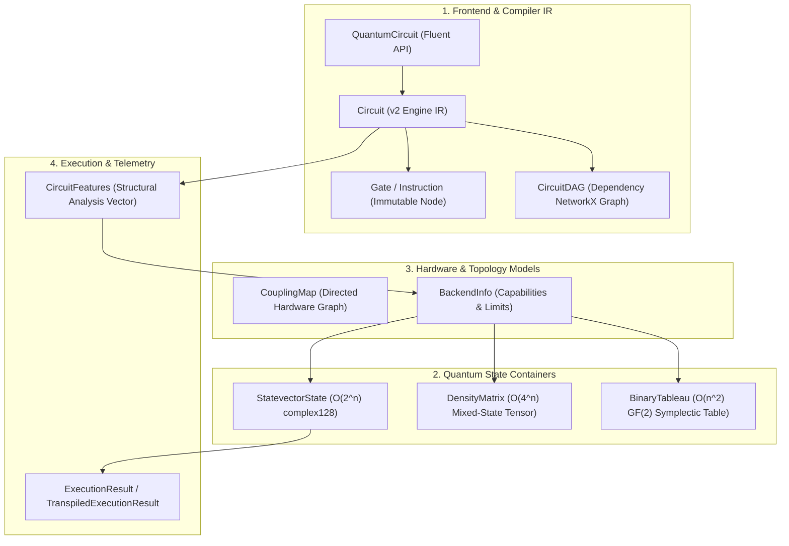

# ZQL-02B | SDK Data Structures & Memory Layouts

## Learning Objectives
- Understand the core data structures that form Zuntenium's compiler IR and execution payloads.
- Master the memory layouts and physical scaling laws for Statevectors, Density Matrices, and Binary Tableaux.
- Analyze the DAG representation used in transpilation passes.
- Inspect topology graphs (`CouplingMap`) and runtime execution containers (`CircuitFeatures`, `ExecutionResult`).

---

## 1. Data Structure Hierarchy

The Zuntenium SDK organizes its data structures into four distinct layers:



---

## 2. Frontend & Compiler Intermediate Representation (IR)

### 2.1 The `Gate` Data Structure (`zuntenium.transpiler.v2.core`)

Every quantum operation in the compiler IR is represented as an instance of `Gate`:

```python
@dataclass
class Gate:
    name: str                           # Uppercase gate mnemonic ('H', 'CX', 'RZ')
    targets: Tuple[int, ...]           # Target qubit indices
    controls: Tuple[int, ...] = ()     # Control qubit indices (empty for single-qubit)
    params: Tuple[float, ...] = ()     # Floating-point parameters (e.g., rotation angles)
    metadata: Dict[str, Any] = field(default_factory=dict)
    uid: str = field(default_factory=lambda: str(uuid.uuid4())[:8])
```

#### Invariants & Validation:
- **Immutability & Safety**: Angles are validated at construction to ensure they are finite ($\neg\text{NaN}, \neg\text{Inf}$).
- **Structural Equality**: `gate1.structural_eq(gate2)` compares name, targets, controls, and numerical parameters (within floating-point tolerance $\epsilon=10^{-9}$), ignoring ephemeral metadata and UIDs.

### 2.2 The `Circuit` Container (`zuntenium.transpiler.v2.core`)

The compilation engine uses `Circuit` for $O(1)$ and $O(N)$ transformation passes:

```python
class Circuit:
    def __init__(self, num_qubits: int, name: str = ""):
        self._num_qubits: int = num_qubits
        self._gates: List[Gate] = []
        self._timelines: Dict[int, List[int]] = defaultdict(list)
        self._dag: Optional[nx.DiGraph] = None
        self._dirty_dag: bool = False
```

#### Key Capabilities:
1. **Timeline Indexing (`_timelines`)**: Maps each qubit index `q` to an ordered list of gate indices in `_gates`, allowing $O(1)$ lookup of predecessors and successors.
2. **Batch Gate Removal (`batch_remove`)**: Removes sets of gates in a single $O(N)$ pass, rebuilding timeline indices only once rather than incurring $O(N^2)$ array shifts.

```python
from zuntenium.transpiler.v2.core import Circuit, Gate

circ = Circuit(num_qubits=2)
circ.add_gate(Gate("H", targets=(0,)))
circ.add_gate(Gate("CX", targets=(1,), controls=(0,)))

print(f"Num qubits: {circ.num_qubits}, Num gates: {circ.num_gates}")
```

### 2.3 The `CircuitDAG` Graph (`zuntenium.transpiler.ai.ir`)

Transpiler passes such as gate cancellation, commutation analysis, and SABRE routing convert the linear circuit into a Directed Acyclic Graph (DAG) using `NetworkX`:

- **Nodes**: Represent `Gate` operations with attributes `qubits`, `name`, `duration`.
- **Directed Edges**: Represent causal dependencies. An edge $(u, v)$ indicates that gate $u$ must execute before gate $v$ because they share at least one qubit.

---

## 3. Quantum State Representations & Memory Scaling

The choice of data structure directly dictates the maximum problem size that can be simulated:

| State Data Structure | Mathematical Model | Space Complexity | Qubit Limit (16 GiB RAM) | Best For |
|:---------------------|:-------------------|:-----------------|:-------------------------|:---------|
| **`StatevectorState`** | $|\psi\rangle \in \mathbb{C}^{2^n}$ | $O(2^n)$ | $\le 30$ qubits | Arbitrary universal circuits |
| **`DensityMatrix`** | $\rho \in \mathbb{C}^{2^n \times 2^n}$ | $O(4^n)$ | $\le 15$ qubits | Noisy circuits, open systems |
| **`BinaryTableau`** | $2n \times (2n+1)$ over $\mathbb{F}_2$ | $O(n^2)$ | $\le 10,000$ qubits | Clifford / stabilizer circuits |

### 3.1 `StatevectorState` Memory Layout

Stores $2^n$ complex amplitudes in contiguous C-order `np.complex128` (16 bytes per complex number):

$$\text{Memory (bytes)} = 2^n \times 16$$

```python
from zuntenium.quantum_core.statevector.statevector_state import StatevectorState

state = StatevectorState(num_qubits=3)
# state.data is a contiguous np.ndarray of shape (8,) with dtype complex128
print("Shape:", state.data.shape, "Dtype:", state.data.dtype)
```

Memory consumption table:
- **$n = 10$**: $1,024 \times 16\text{ B} = 16\text{ KiB}$
- **$n = 20$**: $1,048,576 \times 16\text{ B} = 16\text{ MiB}$
- **$n = 30$**: $1,073,741,824 \times 16\text{ B} = 16\text{ GiB}$

### 3.2 `DensityMatrix` Tensor Layout

Stores an explicit $2^n \times 2^n$ matrix:

$$\text{Memory (bytes)} = 4^n \times 16$$

- **$n = 10$**: $1,048,576 \times 16\text{ B} = 16\text{ MiB}$
- **$n = 15$**: $1,073,741,824 \times 16\text{ B} = 16\text{ GiB}$

```python
from zuntenium.quantum_core.statevector.density_matrix import DensityMatrix

dm = DensityMatrix(num_qubits=2)
# Initializes to |00><00|
print("Matrix shape:", dm.matrix.shape)  # (4, 4)
print("Purity:", dm.purity())            # 1.0
```

### 3.3 `BinaryTableau` Symplectic Layout

The stabilizer simulator ([`zuntenium/backends/stabilizer.py`](file:///home/vincent/Downloads/zuntenium/zuntenium/backends/stabilizer.py)) implements the Aaronson-Gottesman representation:

$$T = \begin{pmatrix} X_{1,1} & \dots & X_{1,n} & Z_{1,1} & \dots & Z_{1,n} & r_1 \\ \vdots & \ddots & \vdots & \vdots & \ddots & \vdots & \vdots \\ X_{2n,1} & \dots & X_{2n,n} & Z_{2n,1} & \dots & Z_{2n,n} & r_{2n} \end{pmatrix} \in \mathbb{F}_2^{2n \times (2n+1)}$$

* Rows $1 \dots n$: Destabilizer generators.
* Rows $n+1 \dots 2n$: Stabilizer generators.
* Column $2n+1$: Phase vector $r \in \{0, 1\}^{2n}$ representing $(-1)^{r_i}$.

Because each entry is a single bit, simulating 1,000 qubits requires only $\approx 250\text{ KiB}$ of memory.

---

## 4. Hardware & Topology Data Structures

### 4.1 `CouplingMap` (`zuntenium.transpiler.coupling_map`)

Hardware QPUs cannot execute two-qubit gates between arbitrary pairs of qubits. The `CouplingMap` models the physical layout:

```python
from zuntenium.transpiler.coupling_map import CouplingMap

# 3-qubit linear chain: 0 <-> 1 <-> 2
edges = [(0, 1), (1, 2)]
cmap = CouplingMap(num_qubits=3, edges=edges)

print("Distance 0 to 2:", cmap.distance(0, 2))  # 2 (requires 1 SWAP)
print("Neighbors of 1:", cmap.neighbors(1))      # {0, 2}
```

---

## 5. Execution & Analysis Data Structures

### 5.1 `CircuitFeatures` (`zuntenium.execution.adaptive_engine`)

The Adaptive Engine inspects quantum circuits to extract a structural feature vector:

```python
@dataclass
class CircuitFeatures:
    num_qubits: int
    depth: int
    gate_counts: Dict[str, int]
    clifford_purity: float          # 1.0 = purely Clifford
    entanglement_metric: float       # Two-qubit gate ratio
    connectivity_density: float      # Graph density of qubit interactions
    estimated_memory_mb: float       # Estimated statevector memory footprint
```

### 5.2 `ExecutionResult` (`zuntenium.execution.quantum_executor`)

The final payload returned by all backend executions:

```python
@dataclass
class TranspiledExecutionResult:
    statevector: Optional[np.ndarray]   # None for density matrix or real hardware
    probabilities: np.ndarray           # Basis state probabilities P(x)
    counts: Dict[str, int]             # Shot histogram: {"00": 512, "11": 512}
    num_qubits: int
    shots: int
    execution_time_ms: float
    total_time_ms: float
    circuit_depth: int
    num_gates_executed: int
    metadata: Dict[str, Any]
```

---

## 6. Summary Checklist
- [x] Compilation IR is based on hardened `Gate` nodes and timeline-indexed `Circuit`.
- [x] Statevector memory scales as $2^n \times 16\text{ B}$; density matrices scale as $4^n \times 16\text{ B}$.
- [x] Clifford circuits are modeled using the Aaronson-Gottesman `BinaryTableau` in $O(n^2)$ space.
- [x] QPU connectivity constraints are captured by `CouplingMap` distance matrices.
- [x] Standardized execution results are delivered through `ExecutionResult`.
