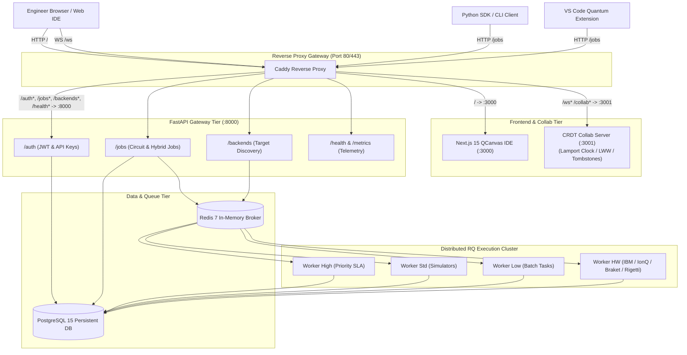
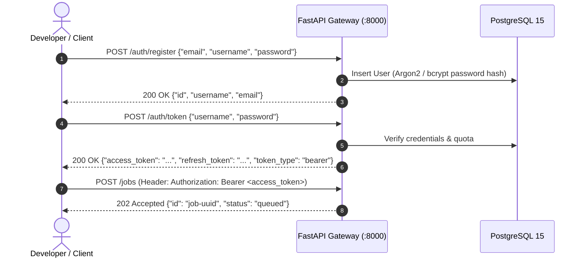

# ZQL-14 | Developer Operations & Live Platform Ecosystem

## Course Overview & Learning Objectives
Welcome to the operational masterclass for the **Zuntenium Cloud Platform, QCanvas Visual Workspace, and Distributed Execution Architecture**. This course demystifies every developer operation, service endpoint, and real-time protocol powering the live Zuntenium ecosystem at `http://104.236.218.164`.

By the end of this module, learners and developers will:
1. Understand the full microservice topology connecting Caddy, Next.js 15, FastAPI, Redis, PostgreSQL, RQ Workers, and the CRDT Collab Server.
2. Proficiently navigate the **QCanvas Visual IDE** (`http://104.236.218.164/`) to visually assemble, inspect, and export quantum circuits.
3. Master the **Interactive REST API** (`http://104.236.218.164/docs`) to programmatically register accounts, generate JWT/API tokens, dispatch asynchronous quantum jobs, and inspect fidelity telemetry.
4. Integrate **Health and Telemetry Probes** (`/health`, `/metrics`) into production monitoring, Prometheus, and automated uptime alerts.
5. Query and dynamically route quantum circuits across simulators (`statevector`, `tensornetwork`, `stabilizer`) and physical QPU targets via `/backends`.
6. Engage the **Real-Time Collaboration WebSocket Engine** (`ws://104.236.218.164/ws`) using Conflict-Free Replicated Data Types (CRDT) to synchronize live canvas sessions across multiple engineers.
7. Execute an end-to-end operational pipeline integrating Python SDK, Web UI, REST Gateway, and collaborative pairing.

---

## 1. Live Infrastructure & Service Endpoints Map

The live production deployment hosted at IP `104.236.218.164` operates behind a high-performance **Caddy reverse proxy** that routes traffic to specialized containerized microservices:

| Service / Tool | Live URL / Endpoint | Protocol & Port | Operational Role | Health / Status |
|---|---|---|---|---|
| **Visual Workspace UI** | `http://104.236.218.164/` | HTTP (Next.js 15 on `:3000`) | Drag-and-drop circuit canvas, gate palette, live Bloch spheres, statevector viewer | Online (200 OK) |
| **Interactive API Docs** | `http://104.236.218.164/docs` | HTTP (FastAPI Swagger `:8000`) | Interactive OpenAPI/Swagger documentation, schema exploration, test harness | Online (200 OK) |
| **API Health Probe** | `http://104.236.218.164/health` | HTTP (FastAPI `:8000`) | Gateway liveness probe, version reporting, uptime monitoring endpoint | Healthy (200 OK) |
| **Quantum Backends Discovery** | `http://104.236.218.164/backends` | HTTP (FastAPI `:8000`) | Dynamic capability probe, simulator limits, QPU status, live queue depths | Online (200 OK) |
| **Real-Time Collaboration** | `ws://104.236.218.164/ws` | WebSocket (Node.js `:3001`) | CRDT multi-user canvas pairing, presence cursors, version snapshots | Active (3001) |
| **Prometheus Telemetry** | `http://104.236.218.164/metrics` | HTTP (FastAPI `:8000`) | Prometheus time-series metrics: job counters, execution histograms, queue gauges | Active (200 OK) |

### Global Architecture Diagram



---

## 2. Visual Workspace UI (Next.js 15 QCanvas IDE)

The **QCanvas IDE** at `http://104.236.218.164/` provides a visual, zero-install interface for circuit synthesis, simulation, and team pairing.

### 2.1 Core Interface Components

```
┌─────────────────────────────────────────────────────────────────────────────┐
│  Zuntenium QCanvas IDE           [Backend: statevector ▼] [Shots: 1024] [Run ▶]│
├───────────────┬─────────────────────────────────────────────────────────────┤
│ GATE PALETTE  │ CIRCUIT CANVAS (Columns 0 → 15)                             │
│ ────────────  │                                                             │
│ [ H ]  [ X ]  │ q[0] ───[ H ]───●──────────────[ M ]─────────────────────────│
│ [ Y ]  [ Z ]  │                 │                                           │
│ [ S ]  [ T ]  │ q[1] ───────────X──────────────[ M ]─────────────────────────│
│ [Rx ]  [Ry ]  ├─────────────────────────────────────────────────────────────┤
│ [Rz ]  [CZ ]  │ LIVE INSPECTION PANEL                                       │
│ [SWAP] [CCX]  │ Statevector: 0.707|00⟩ + 0.707|11⟩                          │
│ [Measure]     │ Counts: {"00": 512, "11": 512}                              │
│               │ Bloch Sphere q[0]: (θ=π/2, φ=0)                             │
└───────────────┴─────────────────────────────────────────────────────────────┘
```

1. **Gate Palette**:
   - **Single-Qubit Standard**: `H` (Hadamard), `X` (Pauli-X/NOT), `Y`, `Z`, `S` ($\pi/2$ phase), `T` ($\pi/4$ phase).
   - **Parametric Rotations**: `Rx(θ)`, `Ry(θ)`, `Rz(θ)` with interactive slider dials $[0, 2\pi]$.
   - **Multi-Qubit Entanglers**: `CX` (CNOT), `CZ` (Controlled-Z), `SWAP`, and `CCX` (Toffoli).
   - **Measurement**: Selective qubit measurement flags targeting classical registers.
2. **Interactive Canvas**:
   - Qubit wire lines ($q_0, q_1, \dots, q_N$).
   - Discrete column time steps. Dragging a gate onto a wire snaps to the nearest available column.
   - Entanglement connections render vertical connection lines between control and target qubits.
3. **Live Bloch Sphere & Statevector Inspection**:
   - For circuits up to 16 qubits, local JavaScript/WASM statevector computation evaluates state amplitudes $\alpha |0\rangle + \beta |1\rangle$ and Bloch sphere polar coordinates $(\theta, \phi)$ in real time as gates are moved.
4. **Code & IR Export**:
   - **OpenQASM 2.0**: Standardized intermediate format for cross-platform portability.
   - **Python SDK Script**: Instant copyable snippet using `from zuntenium.circuit import QuantumCircuit`.
   - **JSON Intermediate Representation (IR)**: Raw wire format accepted by the Cloud REST API.

---

## 3. Interactive API Docs & REST Gateway

The live Swagger UI at `http://104.236.218.164/docs` exposes the full API specification conforming to OpenAPI 3.1. Alternative redoc documentation is available at `http://104.236.218.164/redoc`.

### 3.1 Authentication & Token Lifecycle

Access to compute queues is secured via JSON Web Tokens (JWT) using HMAC-SHA256:



#### Authentication with cURL
```bash
# 1. Register account
curl -X POST "http://104.236.218.164/auth/register" \
  -H "Content-Type: application/json" \
  -d '{"email": "engineer@quantum.org", "username": "qengineer", "password": "SecurePassword123!"}'

# 2. Acquire JWT Bearer Token
TOKEN=$(curl -s -X POST "http://104.236.218.164/auth/token" \
  -H "Content-Type: application/json" \
  -d '{"username": "qengineer", "password": "SecurePassword123!"}' | jq -r '.access_token')

echo "Acquired Token: $TOKEN"
```

### 3.2 Programmatic Python Client for Job Execution

Use this end-to-end Python script to authenticate, submit a circuit job, poll its queue status, and retrieve results:

```python
import time
import requests

API_URL = "http://104.236.218.164"

class ZunteniumCloudClient:
    def __init__(self, base_url: str = API_URL):
        self.base_url = base_url.rstrip("/")
        self.token = None

    def login(self, username: str, password: str):
        resp = requests.post(
            f"{self.base_url}/auth/token",
            json={"username": username, "password": password}
        )
        resp.raise_for_status()
        self.token = resp.json()["access_token"]
        return self.token

    def _headers(self):
        return {
            "Content-Type": "application/json",
            "Authorization": f"Bearer {self.token}"
        }

    def submit_circuit_job(self, num_qubits: int, gates: list, backend: str = "statevector", shots: int = 1024):
        payload = {
            "job_type": "circuit",
            "circuit": {
                "num_qubits": num_qubits,
                "name": "CloudBellCircuit",
                "gates": gates
            },
            "backend": backend,
            "shots": shots,
            "mitigation_enabled": True,
            "optimization_mode": "rule",
            "priority": 5
        }
        resp = requests.post(f"{self.base_url}/jobs", json=payload, headers=self._headers())
        resp.raise_for_status()
        return resp.json()["id"]

    def poll_result(self, job_id: str, timeout_s: int = 60, interval_s: float = 1.0):
        start_time = time.time()
        while time.time() - start_time < timeout_s:
            status_resp = requests.get(f"{self.base_url}/jobs/{job_id}/status", headers=self._headers())
            status_resp.raise_for_status()
            status_data = status_resp.json()
            job_status = status_data["status"]

            if job_status == "completed":
                result_resp = requests.get(f"{self.base_url}/jobs/{job_id}/result", headers=self._headers())
                result_resp.raise_for_status()
                return result_resp.json()
            elif job_status == "failed":
                raise RuntimeError(f"Job failed on cloud worker.")
            
            time.sleep(interval_s)
        raise TimeoutError(f"Job {job_id} timed out after {timeout_s}s")

# Example Usage:
if __name__ == "__main__":
    client = ZunteniumCloudClient()
    # Replace with valid credentials:
    # client.login("qengineer", "SecurePassword123!")
    # job_id = client.submit_circuit_job(
    #     num_qubits=2,
    #     gates=[
    #         {"name": "h", "qubits": [0], "params": []},
    #         {"name": "cx", "qubits": [0, 1], "params": []}
    #     ],
    #     backend="statevector",
    #     shots=1024
    # )
    # print("Job submitted with ID:", job_id)
    # result = client.poll_result(job_id)
    # print("Counts:", result["counts"])
```

---

## 4. Quantum Backends Discovery (`/backends`)

The endpoint `GET http://104.236.218.164/backends` exposes available quantum compute targets, their maximum qubit capacity, hardware status, and real-time Redis queue depths.

### 4.1 Backend Catalog & Capabilities

```json
{
  "backends": [
    {
      "name": "statevector",
      "available": true,
      "description": "Exact statevector simulation (complex128, up to 28 qubits)",
      "max_qubits": 28,
      "queue_depth": 0,
      "avg_wait_s": 0.1
    },
    {
      "name": "tensornetwork",
      "available": true,
      "description": "MPS-based simulation (50–200+ qubits with bond dimension control)",
      "max_qubits": 200,
      "queue_depth": 0,
      "avg_wait_s": 0.5
    },
    {
      "name": "stabilizer",
      "available": true,
      "description": "Clifford-circuit simulator using Gottesman-Knill tableau (up to 10,000 qubits)",
      "max_qubits": 10000,
      "queue_depth": 0,
      "avg_wait_s": 0.2
    },
    {
      "name": "gpu_statevector",
      "available": true,
      "description": "GPU-accelerated statevector simulation (CuPy/JAX with NumPy fallback)",
      "max_qubits": 30,
      "queue_depth": 0,
      "avg_wait_s": 0.05
    },
    {
      "name": "ibm",
      "available": false,
      "description": "IBM Quantum real hardware (requires IBM credentials)",
      "max_qubits": 127,
      "queue_depth": 0,
      "avg_wait_s": 45.0
    },
    {
      "name": "ionq",
      "available": false,
      "description": "IonQ Quantum Cloud (requires credentials and provider SDK)",
      "max_qubits": 36,
      "queue_depth": 0,
      "avg_wait_s": 30.0
    }
  ]
}
```

### 4.2 How to Query Backends via cURL
```bash
curl -s "http://104.236.218.164/backends" | jq '.backends[] | {name, max_qubits, available, queue_depth}'
```

### 4.3 Intelligent Routing Matrix
When submitting a circuit without an explicit backend or via `MHOS` (Multi-Hardware Orchestration System), the platform evaluates:
1. **Entangling Structure**: Non-Clifford $T$ or rotation gates route to `statevector` or `tensornetwork`. Pure Clifford circuits (`H`, `S`, `CX`, `CZ`) route to `stabilizer` for $O(N^2)$ execution speed.
2. **Qubit Count**: Circuits with $N > 28$ automatically route to `tensornetwork` or `stabilizer`.
3. **Queue Latency**: If the hardware queue depth exceeds user SLA, MHOS can automatically route to high-fidelity noise-modeled simulators.

---

## 5. Real-Time Collaboration Engine (`ws://104.236.218.164/ws`)

The real-time collaboration server at `ws://104.236.218.164/ws` enables live multi-engineer pair programming on quantum circuits using **Conflict-Free Replicated Data Types (CRDT)**.

### 5.1 CRDT Theoretical Model

To prevent synchronization divergence without requiring distributed locking on every keystroke, the server uses:
1. **Lamport Logical Timestamps**: Every operation increments a logical clock: $L_{new} = \max(L_{local}, L_{incoming}) + 1$.
2. **Last-Write-Wins (LWW) Register per Gate**: Each gate ID maintains a register. If concurrent edits happen to the same gate, the edit with the higher Lamport clock (broken by deterministic `authorId` tiebreak) wins.
3. **Permanent Tombstone Sets**: When a gate is deleted, its `gateId` is added to a permanent tombstone set. Deletion always takes precedence over concurrent modification (`deletion_wins`).

```
Client A (Lamport: 5) ───[ Move Gate G1 to Col 3 ]───┐
                                                     ├─► CRDT Engine:
Client B (Lamport: 6) ───[ Delete Gate G1 ]──────────┘   Tombstone wins → G1 Deleted
```

### 5.2 WebSocket Message Protocol

The wire protocol communicates via UTF-8 JSON frames:

#### 1. Handshake (`JOIN_SESSION`)
```json
{
  "type": "JOIN_SESSION",
  "sessionId": "room-bell-experiment",
  "userId": "usr_vincent",
  "userName": "Vincent Kimuri",
  "role": "editor"
}
```
**Server Response (`SESSION_JOINED`)**:
```json
{
  "type": "SESSION_JOINED",
  "sessionId": "room-bell-experiment",
  "userId": "usr_vincent",
  "role": "owner",
  "color": "#6366f1",
  "circuit": {
    "numQubits": 2,
    "name": "EntanglementDemo",
    "gates": []
  },
  "presence": [
    { "userId": "usr_vincent", "userName": "Vincent Kimuri", "color": "#6366f1" }
  ]
}
```

#### 2. Gate Mutation (`CIRCUIT_OPERATION`)
```json
{
  "type": "CIRCUIT_OPERATION",
  "operation": {
    "type": "ADD_GATE",
    "gateId": "gate_h_q0_c0",
    "gate": {
      "id": "gate_h_q0_c0",
      "name": "h",
      "qubit": 0,
      "col": 0,
      "params": []
    }
  }
}
```
**Server Broadcast (`CIRCUIT_OPERATION`)**: Broadcasted immediately to all other participants in the room.

#### 3. Live Presence & Cursors (`CURSOR_UPDATE`)
```json
{
  "type": "CURSOR_UPDATE",
  "cursor": { "x": 140, "y": 80 },
  "selection": { "qubit": 0, "col": 0 }
}
```

#### 4. Shared Execution Lock (`EXECUTE_CIRCUIT`)
```json
{
  "type": "EXECUTE_CIRCUIT",
  "backend": "statevector",
  "shots": 1024
}
```
The server broadcasts `EXECUTION_STARTED`, locks the canvas, dispatches the job to the cloud worker, and broadcasts `EXECUTION_COMPLETED` containing the joint counts and statevector when ready.

### 5.3 Live Python WebSocket Pairing Script

You can connect to a collaboration session directly from Python:

```python
import asyncio
import json
import websockets

WS_URL = "ws://104.236.218.164/ws"

async def participate_in_circuit_pairing():
    async with websockets.connect(WS_URL) as ws:
        # 1. Join room
        join_payload = {
            "type": "JOIN_SESSION",
            "sessionId": "lab-session-01",
            "userId": "dev_alex",
            "userName": "Alex (Quantum Researcher)",
            "role": "editor"
        }
        await ws.send(json.dumps(join_payload))
        
        # 2. Wait for initial state snapshot
        init_msg = json.loads(await ws.recv())
        print(f"Joined room! Current gates in canvas: {len(init_msg['circuit']['gates'])}")

        # 3. Add Hadamard gate on Qubit 0
        gate_op = {
            "type": "CIRCUIT_OPERATION",
            "operation": {
                "type": "ADD_GATE",
                "gateId": "h_gate_0",
                "gate": {
                    "id": "h_gate_0",
                    "name": "h",
                    "qubit": 0,
                    "col": 0,
                    "params": []
                }
            }
        }
        await ws.send(json.dumps(gate_op))
        print("Dispatched ADD_GATE operation to live canvas.")

        # 4. Listen for peer events
        while True:
            raw_event = await ws.recv()
            event = json.loads(raw_event)
            print(f"Incoming event from peer: {event['type']}")
            if event["type"] == "EXECUTION_COMPLETED":
                print("Remote execution completed with counts:", event.get("counts"))
                break

if __name__ == "__main__":
    # asyncio.run(participate_in_circuit_pairing())
    pass
```

---

## 6. Operational Health Probes & Prometheus Telemetry

### 6.1 Liveness Probe (`GET /health`)
The gateway exposes a lightweight HTTP 200 health check at:
```bash
curl -i http://104.236.218.164/health
```
**HTTP Response:**
```http
HTTP/1.1 200 OK
Content-Type: application/json
Content-Length: 68

{
  "status": "ok",
  "version": "4.0.0",
  "timestamp": "2026-10-11T21:05:00.000000+00:00"
}
```

#### Production Monitoring Integration
- **Kubernetes Liveness & Readiness**:
  ```yaml
  livenessProbe:
    httpGet:
      path: /health
      port: 8000
    initialDelaySeconds: 5
    periodSeconds: 10
  ```
- **Docker Compose Healthcheck**:
  ```yaml
  healthcheck:
    test: ["CMD", "curl", "-f", "http://localhost:8000/health"]
    interval: 15s
    timeout: 5s
    retries: 3
  ```

### 6.2 Prometheus Telemetry (`GET /metrics`)
Metrics in standard Prometheus text format are exported at:
```bash
curl -s http://104.236.218.164/metrics | grep zuntenium
```
Key production metrics tracked:
- `zuntenium_jobs_submitted_total{backend="statevector", job_type="circuit"}`: Monotonically increasing counter of submitted jobs.
- `zuntenium_jobs_completed_total{backend="statevector", status="completed"}`: Counter of successful executions.
- `zuntenium_active_jobs`: Instantaneous gauge of executing jobs.
- `zuntenium_queue_depth{queue="default"}`: Instantaneous gauge of pending Redis RQ tasks.
- `zuntenium_job_duration_seconds_bucket`: Histogram distribution of execution latencies.

---

## 7. Unified End-to-End Operational Pipeline

Here is the complete operational playbook for an engineer engaging the live Zuntenium ecosystem:

```
[ Step 1: Health Check ]
  curl http://104.236.218.164/health (Verify 200 OK)
            │
            ▼
[ Step 2: Capability Discovery ]
  curl http://104.236.218.164/backends (Verify queue depth & max qubits)
            │
            ▼
[ Step 3: Interactive Visual Design ]
  Open http://104.236.218.164/ (Assemble circuit on QCanvas IDE)
            │
            ▼
[ Step 4: Real-Time Team Pairing ]
  Connect ws://104.236.218.164/ws (Invite co-researcher to collaborate)
            │
            ▼
[ Step 5: Distributed Execution ]
  Submit via IDE or REST POST /jobs (Dispatched to RQ Worker cluster)
            │
            ▼
[ Step 6: Telemetry & Results Analysis ]
  Fetch GET /jobs/{id}/result (Inspect counts, statevector, and PEC fidelity)
```

---

## Summary of Operational Best Practices
1. **Always Verify Health Before Large Batches**: Query `/health` and inspect `/backends` queue depth to avoid queue saturation during peak loads.
2. **Use API Keys for Automated CI/CD**: For unattended automated scripts or GitHub Actions pipelines, generate non-expiring API keys under `/auth/api-keys` instead of short-lived user passwords.
3. **Leverage CRDT Sessions for Remote Workshops**: Use room-based WebSocket sessions (`ws://104.236.218.164/ws`) for collaborative tutoring and live team review of quantum circuits.
4. **Select Appropriate Backends**: Direct circuits with $N \le 28$ to `statevector`, Clifford circuits to `stabilizer`, and large-scale entangled systems ($N \le 200$) to `tensornetwork`.
