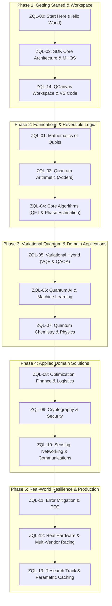

# Zuntenium Quantum Learning (ZQL)

Welcome to **Zuntenium Quantum Learning (ZQL)**, the official comprehensive documentation, theory course, and technical curriculum for the **Zuntenium Hybrid Quantum SDK** and **QCanvas Quantum Workspace**.

---

## Curriculum Architecture & Sitemap

ZQL is structured systematically into 5 distinct phases spanning foundations, SDK operations, hybrid variational algorithms, domain applications, and advanced quantum hardware engineering.



---

## Syllabus Overview

### Phase 1: Onboarding, Core Architecture & Workspace
* **[ZQL-00 | Start Here: Hello World](ZQL-00-start-here.md)**: Install Zuntenium, build your first Bell state via fluent builder, execute against local statevector engines, and inspect shot statistics.
* **[ZQL-02 | SDK Core Reference](ZQL-02-sdk-core-reference.md)**: Internal representations (IR), transpilation optimization pipeline, and Multi-Hardware Orchestration System (MHOS).
* **[ZQL-14 | Quantum Workspace Guide](ZQL-14-workspace-guide.md)**: Interactive QCanvas circuit designer, FastAPI workspace server, and VS Code extension integration.

### Phase 2: Quantum Foundations & Reversible Logic
* **[ZQL-01 | Quantum Foundations & Mathematics](ZQL-01-quantum-foundations.md)**: Hilbert space, Dirac notation, matrix mechanics of single and two-qubit unitary operators, and projection measurement.
* **[ZQL-03 | Quantum Arithmetic & Logic](ZQL-03-quantum-arithmetic.md)**: Reversible Boolean computation, Toffoli gates, ancilla recycling, and quantum half/full adders.
* **[ZQL-04 | Core Quantum Algorithms](ZQL-04-core-algorithms.md)**: Quantum Fourier Transform (QFT), Quantum Phase Estimation (QPE), and Grover search sequences.

### Phase 3: Variational Hybrid & Emerging Paradigms
* **[ZQL-05 | Variational & Hybrid Quantum Algorithms](ZQL-05-variational-hybrid.md)**: Native `Hamiltonian` & `PauliString` formulation, VQE ground-state finding, and QAOA execution.
* **[ZQL-06 | Quantum AI & Machine Learning](ZQL-06-quantum-ai-ml.md)**: Quantum neural network architectures, kernel methods (QSVM), and parameter optimization.
* **[ZQL-07 | Quantum Chemistry, Materials & Physics](ZQL-07-chemistry-physics.md)**: Second quantization, Jordan-Wigner transformation, and molecular Hamiltonian simulation.

### Phase 4: Applied Domain Solutions
* **[ZQL-08 | Optimization, Finance & Logistics](ZQL-08-optimization-finance.md)**: Mapping quadratic unconstrained binary optimization (QUBO) and MaxCut to Pauli-Z Ising models.
* **[ZQL-09 | Quantum Cryptography & Security](ZQL-09-crypto-security.md)**: Post-quantum cryptography readiness, Shor's factoring analysis, and BB84 quantum key distribution.
* **[ZQL-10 | Quantum Sensing & Networking](ZQL-10-sensing-network.md)**: Entanglement-enhanced metrology, Ramsey interferometry, and quantum teleportation protocols.

### Phase 5: Production Reliability & Advanced Research
* **[ZQL-11 | Error Mitigation & Resilience](ZQL-11-error-mitigation.md)**: Noise modeling, Zero-Noise Extrapolation (ZNE), and Probabilistic Error Cancellation (PEC).
* **[ZQL-12 | Real Hardware Integration](ZQL-12-real-hardware.md)**: `HardwareOrchestrator`, multi-provider execution strategies (RACING, FALLBACK), and physical calibration.
* **[ZQL-13 | Research Track & Deep Internals](ZQL-13-research-track.md)**: Transpiler AST analysis, structural template hashing, and $O(1)$ parameter rebinding.

---

## Quickstart

Install Zuntenium via pip:

```bash
pip install zuntenium
```

Construct and execute a Bell-state circuit:

```python
from zuntenium.circuit import QuantumCircuit
from zuntenium.api.quantum_api import execute

# 1. Create a 2-qubit circuit with fluent API
qc = QuantumCircuit(2, name="EntanglementDemo")
qc.h(0).cx(0, 1).measure_all()

# 2. Execute on default statevector backend
result = execute(qc, shots=1024)

# 3. Print counts
print("Measurement counts:", result.counts)
```
